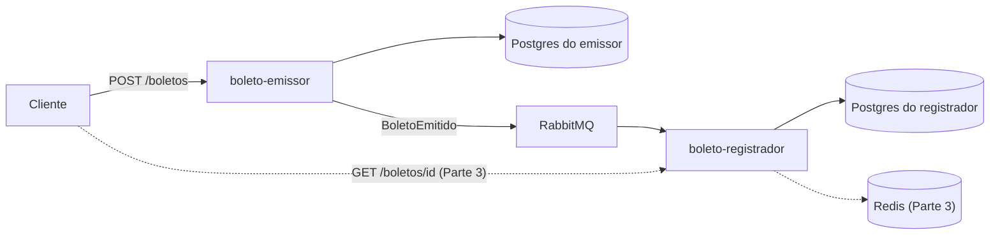

# Central de boletos

Projeto final individual do módulo BE-JV-010 (Ada Tech).

O cliente pede um boleto. O serviço `boleto-emissor` valida o pedido, grava o boleto como `PENDENTE` no Postgres dele e publica `BoletoEmitido` no RabbitMQ. O `boleto-registrador` consome a mensagem, simula o registro no banco e guarda a própria cópia. Se a mesma mensagem chegar de novo, fica uma linha só. A leitura com cache fica para a Parte 3.

Perfil **A**: tudo sobe com Docker.

## Desenho

A linha cheia é o que já roda. A linha pontilhada é o cache, ainda sem código.



## Por que Go

O desafio não prende a stack ao Spring das aulas. Go 1.22 resolve o HTTP, o JSON e os testes com a biblioteca padrão: o `net/http` já roteia por método e caminho. Cada serviço vira um binário só, simples de colocar no Docker. A fila entra por trás de `Publicador` e `Consumidor`. O cache, na Parte 3, entra do mesmo jeito.

## Como rodar

É preciso ter Docker com Compose v2. Na raiz do repositório:

```bash
docker compose up --build
```

| O quê | Onde |
|---|---|
| Emissor | http://localhost:8080 |
| Registrador | http://localhost:8081 |
| Postgres do emissor | localhost:5432 (usuário, senha e banco: `emissor`) |
| Postgres do registrador | localhost:5433 (usuário, senha e banco: `registrador`) |
| RabbitMQ (painel) | http://localhost:15672 (`guest` / `guest`) |
| Redis | localhost:6379 |

As senhas são só para a máquina local da banca.

Saúde dos dois serviços:

```bash
curl -s http://localhost:8080/health
curl -s http://localhost:8081/health
```

Emitir um boleto. O vencimento não pode ser anterior a hoje (dia civil em `America/Sao_Paulo`):

```bash
curl -s -X POST http://localhost:8080/boletos \
  -H 'Content-Type: application/json' \
  -d '{"valor":"150.50","vencimento":"2026-12-31","pagador":"Maria Silva"}'
```

Resposta `201`:

```json
{
  "id": "7c9e6679-7425-40de-944b-e07fc1f90ae7",
  "valor": "150.50",
  "vencimento": "2026-12-31",
  "pagador": "Maria Silva",
  "status": "PENDENTE",
  "criado_em": "2026-11-14T18:00:00Z"
}
```

Pedido inválido responde `400` com `{"erros":["..."]}`.

Conferir a linha no banco do emissor. A coluna é `BIGINT` (`valor_centavos`), a mesma unidade do código: `15050` significa R$ 150,50. O driver não converte decimal na gravação, e o valor não passa por `float`.

```bash
docker compose exec postgres-emissor \
  psql -U emissor -d emissor \
  -c 'select id, valor_centavos, vencimento, pagador, status from boletos;'
```

Espere um instante. A mesma linha aparece no registrador, com status `REGISTRADO`:

```bash
docker compose exec postgres-registrador \
  psql -U registrador -d registrador \
  -c 'select id, valor_centavos, vencimento, pagador, status from boletos_registrados;'
```

No log do registrador, a primeira entrega escreve `boleto registrado`. Para encerrar: `docker compose down`.

## Como conferir a mensagem repetida

A fila entrega "pelo menos uma vez". O registrador grava uma vez só, pela chave primária.

1. Suba o projeto e abra o painel do RabbitMQ em http://localhost:15672 (`guest` / `guest`).
2. Em **Exchanges**, abra `boletos`, em **Publish message**.
3. Routing key: `boleto.emitido`. Payload:

```json
{
  "id": "7c9e6679-7425-40de-944b-e07fc1f90ae7",
  "valor_centavos": 15050,
  "vencimento": "2026-12-31",
  "pagador": "Maria Silva",
  "emitido_em": "2026-11-14T18:00:00Z"
}
```

4. Publique esse JSON duas vezes.
5. Rode o `select` do registrador. Fica uma linha só com esse `id`.
6. No log, a segunda vez aparece como `mensagem repetida, registro já existia`:

```bash
docker compose logs boleto-registrador
```

Um JSON quebrado (por exemplo `{}`) não volta para a fila. Ele cai em **Queues** → `boleto.emitido.dlq`.

## Contrato do POST /boletos

| Campo | Regra |
|---|---|
| `valor` | Texto decimal (`"150.50"`) ou número JSON (`150.50`). Maior que zero, no máximo 2 casas. |
| `vencimento` | `AAAA-MM-DD`. Data real. Anterior a hoje em São Paulo é rejeitada. Hoje passa. |
| `pagador` | Nome, sem CPF. Obrigatório depois do `trim`, no máximo 255 caracteres. |

O serviço gera o `id` e grava `status: "PENDENTE"`. O cliente não escolhe o estado.

A mensagem `BoletoEmitido` leva o que o registrador precisa guardar sem chamar o emissor de volta. `valor_centavos` é inteiro, a mesma unidade do banco:

```json
{
  "id": "7c9e6679-7425-40de-944b-e07fc1f90ae7",
  "valor_centavos": 15050,
  "vencimento": "2026-12-31",
  "pagador": "Maria Silva",
  "emitido_em": "2026-11-14T18:00:00Z"
}
```

O `id` é a chave primária em `boletos_registrados`. O `INSERT` usa `ON CONFLICT (id) DO NOTHING`.

## Decisões

- [ADR-001](docs/adr/ADR-001-banco-por-servico.md): dois serviços, cada um com o seu Postgres.
- [ADR-002](docs/adr/ADR-002-fila-rabbitmq-idempotencia.md): fila em vez de HTTP, e a mensagem repetida não duplica.
- ADR-003 (cache) fica para a Parte 3.

## Status

- Parte 1 (tema, desenho e esqueleto): feita.
- Parte 2 (fila): feita. O emissor publica `BoletoEmitido`. O registrador consome, grava `REGISTRADO` uma vez e confirma a mensagem.
- Parte 3 (cache): pendente. O Redis sobe com o compose. O `GET /boletos/{id}` ainda não existe.

## Uso de IA

O código e os textos foram escritos com assistência de IA no Cursor. As decisões (divisão dos serviços, valor em centavos, vencimento no fuso de São Paulo, fila em vez de HTTP, Go em vez de Spring) foram revistas pelo autor, que explica cada uma na banca.

## Testes

O `go.work` na raiz lista os dois módulos. Da raiz:

```bash
go test ./servicos/boleto-emissor/... ./servicos/boleto-registrador/...
go vet ./servicos/boleto-emissor/... ./servicos/boleto-registrador/...
```

Dentro da pasta de cada serviço, o comando é `go test ./...` e `go vet ./...`.
