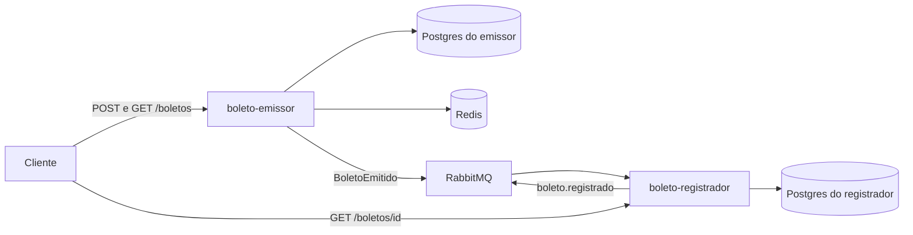

# Central de boletos

Projeto final individual do módulo BE-JV-010 (Ada Tech).

O cliente pede um boleto. O `boleto-emissor` valida, grava `PENDENTE` no Postgres dele e deixa o JSON numa outbox, na mesma transação. Um relay publica `BoletoEmitido` no RabbitMQ quando o broker confirma. O `boleto-registrador` consome, simula o registro e grava a própria cópia uma vez só. Ele devolve `boleto.registrado`. O emissor muda o status para `REGISTRADO` e apaga a cópia no Redis.

Perfil **A**: tudo sobe com Docker.

## Desenho



## Por que Go

O desafio não prende a stack ao Spring das aulas. Go 1.22 resolve o HTTP, o JSON e os testes com a biblioteca padrão: o `net/http` já roteia por método e caminho. Cada serviço vira um binário só, simples de colocar no Docker. A fila fica atrás de um relay e de um consumidor. O cache fica atrás de uma interface pequena, então o GET continua de pé se o Redis cair.

## Como rodar

É preciso ter Docker com Compose v2. Na raiz do repositório:

```bash
docker compose up --build -d
```

| O quê | Onde |
|---|---|
| Emissor | http://localhost:8080 |
| Registrador | http://localhost:8081 |
| Postgres do emissor | localhost:5432 (usuário, senha e banco: `emissor`) |
| Postgres do registrador | localhost:5433 (usuário, senha e banco: `registrador`) |
| RabbitMQ (painel) | http://localhost:15672 (`guest` / `guest`) |
| Redis | localhost:6379 |

As senhas são só para a máquina local da banca.

```bash
curl -s http://localhost:8080/health
curl -s http://localhost:8081/health
```

Emitir um boleto. O vencimento não pode ser anterior a hoje (dia civil em `America/Sao_Paulo`):

```bash
curl -s -X POST http://localhost:8080/boletos \
  -H 'Content-Type: application/json' \
  -d '{"valor":"150.50","vencimento":"2026-12-31","pagador":"Maria Silva"}'
```

A resposta é `201` mesmo se o RabbitMQ estiver fora, porque a mensagem ficou na outbox. Pedido inválido responde `400` com `{"erros":["..."]}`.

Espere um ou dois segundos. A fila é assíncrona: o emissor grava `PENDENTE` na hora, e o registrador chega logo em seguida com `REGISTRADO`. `valor_centavos` é inteiro: `15050` significa R$ 150,50.

```bash
docker compose exec postgres-emissor \
  psql -U emissor -d emissor \
  -c 'select id, valor_centavos, status from boletos;'

docker compose exec postgres-registrador \
  psql -U registrador -d registrador \
  -c 'select id, valor_centavos, status from boletos_registrados;'
```

Para encerrar: `docker compose down`.

## Como conferir a mensagem repetida

1. Suba o projeto e abra http://localhost:15672 (`guest` / `guest`).
2. Em **Exchanges**, abra `boletos`, em **Publish message**.
3. Routing key: `boleto.emitido`. Payload:

```json
{
  "id": "7c9e6679-7425-40de-944b-e07fc1f90ae7",
  "valor_centavos": 15050,
  "vencimento": "2026-12-31",
  "pagador": "Maria Silva",
  "emitido_em": "2026-11-14T18:00:00Z"
}
```

4. Publique esse JSON duas vezes.
5. O `select` do registrador fica com uma linha só. O log diz `mensagem repetida, registro já existia`.

```bash
docker compose logs boleto-registrador
```

Um JSON quebrado (por exemplo `{}`) cai em **Queues** → `boleto.emitido.dlq`.

## Como conferir o cache

Depois que o emissor estiver `REGISTRADO`:

```bash
curl -sD - http://localhost:8080/boletos/ID | grep -i x-cache
curl -sD - http://localhost:8080/boletos/ID | grep -i x-cache
```

A primeira resposta traz `X-Cache: miss`. A segunda, `X-Cache: hit`. Um id que não existe responde `404` e não é guardado. Se o Redis cair, o header vai `bypass` e o JSON ainda sai do Postgres.

## Como conferir a outbox

```bash
docker compose stop rabbitmq
curl -s -X POST http://localhost:8080/boletos \
  -H 'Content-Type: application/json' \
  -d '{"valor":"10.00","vencimento":"2026-12-31","pagador":"Ana"}'
docker compose start rabbitmq
```

O `POST` responde `201`. A linha nasce na tabela `outbox` com `enviado_em` nulo. Quando o broker volta, o relay publica e preenche `enviado_em`.

O script `./scripts/e2e.sh` faz o caminho feliz: POST, espera o registrador, confere miss e hit, publica a mesma mensagem de novo e exige uma linha só.

## Contrato

| Campo | Regra |
|---|---|
| `valor` | Texto decimal (`"150.50"`) ou número JSON (`150.50`). Maior que zero, no máximo 2 casas. |
| `vencimento` | `AAAA-MM-DD`. Data real. Anterior a hoje em São Paulo é rejeitada. Hoje passa. |
| `pagador` | Nome, sem CPF. Obrigatório depois do `trim`, no máximo 255 caracteres. |

`BoletoEmitido` usa centavos, a mesma unidade do banco:

```json
{
  "id": "7c9e6679-7425-40de-944b-e07fc1f90ae7",
  "valor_centavos": 15050,
  "vencimento": "2026-12-31",
  "pagador": "Maria Silva",
  "emitido_em": "2026-11-14T18:00:00Z"
}
```

O `id` é a chave primária em `boletos_registrados`. O `INSERT` usa `ON CONFLICT (id) DO NOTHING`.

## Decisões

O enunciado pede três ADRs: a divisão dos serviços, a fila e o cache.
Este repositório tem quatro. O quarto existe porque a outbox é outra
decisão, com outras alternativas. Ela não substitui a da fila.

- [ADR-001](docs/adr/ADR-001-banco-por-servico.md): dois serviços, cada um com o seu Postgres.
- [ADR-002](docs/adr/ADR-002-fila-rabbitmq-idempotencia.md): fila em vez de HTTP, entrega pelo menos uma vez, mensagem repetida não duplica.
- [ADR-003](docs/adr/ADR-003-cache-redis.md): o que o cache guarda, o TTL e quando apaga.
- [ADR-004](docs/adr/ADR-004-outbox.md): a publicação sai da mesma transação do boleto.

## Status

- Parte 1 (esqueleto): feita.
- Parte 2 (fila e idempotência): feita.
- Parte 3 (cache): feita. `GET /boletos/{id}` no emissor, com Redis. O registrador também tem GET, sem cache.
- Parte 4 (fechamento): README, ADRs revisados, teste de contrato e o roteiro em `docs/banca.md`.

## Testes

Unidade, dentro de cada serviço ou da raiz. Isso inclui o teste de contrato:

```bash
go test ./servicos/boleto-emissor/... ./servicos/boleto-registrador/...
go vet ./servicos/boleto-emissor/... ./servicos/boleto-registrador/...
```

O contrato mora em `contracts/`. São dois JSON de exemplo (`boleto.emitido` e `boleto.registrado`) e, ao lado, o tipo de cada campo. O teste do emissor codifica um boleto e exige o mesmo JSON. O teste do registrador decodifica esse arquivo e exige os mesmos valores. O outro par faz o inverso com `boleto.registrado`. Se um lado renomear um campo ou trocar `number` por `string`, o teste quebra. Para rodar só esses:

```bash
go test ./servicos/boleto-emissor/internal/boleto ./servicos/boleto-emissor/internal/fila ./servicos/boleto-registrador/internal/registro -run Contrato
```

Integração, com Docker no ar. Sobe Postgres, RabbitMQ e Redis de verdade:

```bash
go test -tags integration -count=1 -timeout 6m ./servicos/boleto-emissor/internal/integra ./servicos/boleto-registrador/internal/integra
```

Ponta a ponta, com o compose no ar:

```bash
docker compose up --build -d
./scripts/e2e.sh
```

## Limitações

- Se o relay cair depois do confirm e antes de marcar a outbox, a mensagem sai de novo. O registrador não duplica a linha.
- Uma leitura que já pegou `PENDENTE` no banco pode gravar essa cópia no Redis logo depois do apagar. O TTL de 5 minutos limita essa janela.
- O aviso `boleto.registrado` não tem outbox. Se a publicação falha, `boleto.emitido` volta para a fila e o aviso é tentado de novo.
- Os dois serviços declaram a mesma topologia. Mudar o argumento de uma fila só de um lado quebra a subida do outro.
- Não há reconexão infinita silenciosa sem log: a queda aparece no log e o loop tenta de novo, com espera de até 15 segundos.

## Uso de IA

O código e os textos foram escritos com assistência de IA no Cursor. As decisões (divisão dos serviços, valor em centavos, vencimento no fuso de São Paulo, fila em vez de HTTP, outbox, cache, Go em vez de Spring) foram revistas pelo autor, que explica cada uma na banca.
